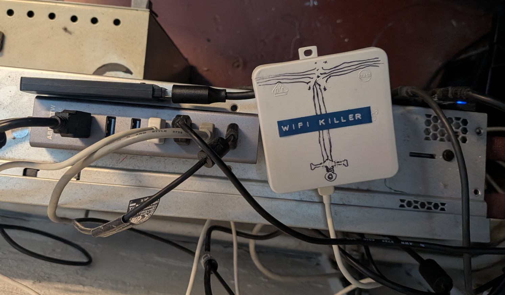
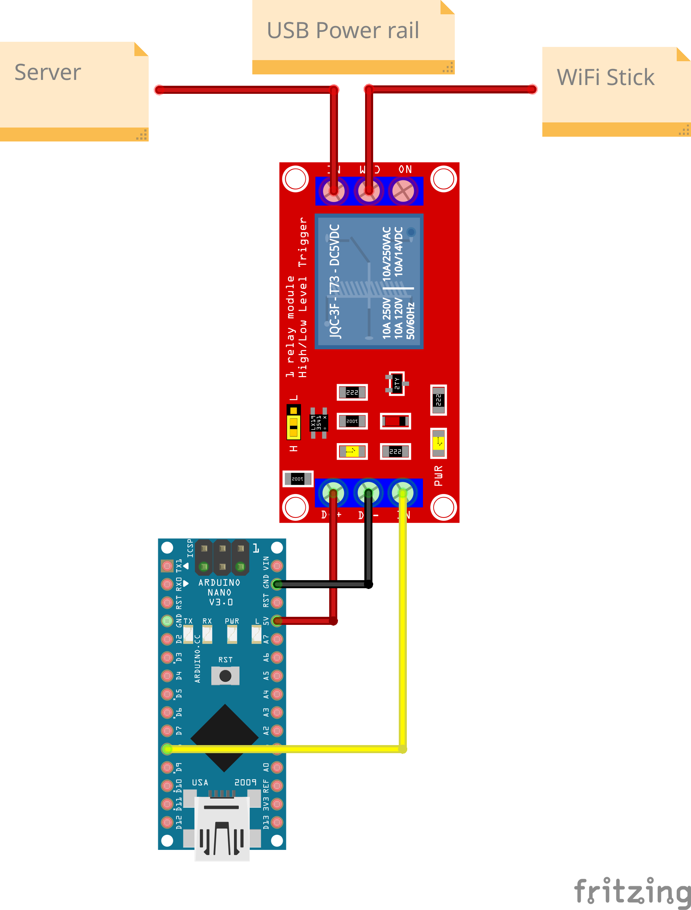

# WiFi Watchdog <!-- omit in toc -->



Our brutal solution for dealing with our server's flaky WiFi connection.

This repository contains firmware for the "WiFi Killer", which can power-cycle our USB WiFi stick via a relay. It also contains the `wifi-watchdog` systemd service, which monitors the server's WiFi connection and performs soft resets or, if unavoidable, hard resets through the WiFi Killer when the connection stalls.

This was developed due to the ever-growing unreliability of our server's WiFi connection. In some cases, this was caused by a stale eduroam connection. In other cases, the WiFi stick got "wedged", meaning it refused to reconnect until it was power-cycled.

## Table of contents <!-- omit in toc -->

- [Hardware Setup](#hardware-setup)
- [WiFi Killer Firmware Installation](#wifi-killer-firmware-installation)
- [Watchdog Installation](#watchdog-installation)
  - [Udev Rules](#udev-rules)
  - [Installation](#installation)
  - [Service Inspection](#service-inspection)
  - [Forced Hard Recovery Test](#forced-hard-recovery-test)
- [Technical details](#technical-details)
- [AI Disclaimer](#ai-disclaimer)


## Hardware Setup

The hardware consists of an Arduino Nano with an ATmega168, connected to a relay that toggles the WiFi stick's power line.

The relay is configured so that the power line is normally closed:

```text
Arduino LOW  = power connected
Arduino HIGH = power interrupted
```



A relay was used instead of a transistor because it can be isolated and therefore does not require a common ground connection.

## WiFi Killer Firmware Installation

The firmware is built with PlatformIO. After installing PlatformIO, build the firmware with:

```bash
pio run -e nanoatmega168
```

Upload it to the connected Nano with:

```bash
pio run -e nanoatmega168 -t upload
```

## Watchdog Installation

First, clone this repository onto the server:

```bash
git clone https://github.com/TuDo-Makerspace/server-wifi-watchdog.git
cd server-wifi-watchdog
```

### Udev Rules

The watchdog expects a stable serial path for the Arduino, normally:

```text
/dev/stick-killer
```

That path is created by the included udev rule:

```text
udev/99-stick-killer.rules
```

Ensure that the WiFi Killer is plugged in. Then install and reload the rule that maps it to `/dev/stick-killer`:

```bash
sudo install -m 0644 udev/99-stick-killer.rules /etc/udev/rules.d/99-stick-killer.rules
sudo udevadm control --reload-rules
sudo udevadm trigger --subsystem-match=tty
ls -l /dev/stick-killer
```

If the WiFi Killer does not appear under `/dev`, it may be plugged into a different USB port. In that case, the `KERNELS=="..."` match in `udev/99-stick-killer.rules` may need to be updated to match the correct port.

You can determine the correct USB path with commands such as:

```bash
dmesg
udevadm info
lsusb -t
```

After updating the rule, reload it again using the commands above.

### Installation

To install the watchdog, run:

```bash
sudo ./scripts/install-watchdog-service.sh --start --enable
```

The installer deploys the following files:

```text
/usr/local/sbin/wifi-watchdog.py
/etc/systemd/system/wifi-watchdog.service
/etc/wifi-watchdog.env
/usr/local/share/wifi-watchdog/README.md
```

On update, existing values in `/etc/wifi-watchdog.env` are preserved, and the old file is backed up.

Review the deployed configuration with:

```bash
sudoedit /etc/wifi-watchdog.env
```

Important settings:

| Setting                  | Meaning                                                              |
| ------------------------ | -------------------------------------------------------------------- |
| `WIFI_STICK_IFACE`       | WiFi interface to monitor, for example `wlx40a5efd86cc5`.            |
| `RELAY_SERIAL`           | Stable serial path for the Arduino, normally `/dev/stick-killer`.    |
| `MIN_SCAN_FAILURES`      | Number of recent scan failures required to trigger recovery.         |
| `MIN_STALE_EVENTS`       | Number of recent WPA churn events required to trigger recovery.      |
| `UNHEALTHY_TIMEOUT`      | Time a non-connected interface may remain unhealthy before recovery. |
| `SOFT_RECOVERY_COOLDOWN` | Minimum time in seconds between soft recovery attempts.              |
| `RECOVERY_COOLDOWN`      | Minimum time in seconds between hard relay recovery attempts.        |

### Service Inspection

Inspect the watchdog service with:

```bash
sudo systemctl status wifi-watchdog.service --no-pager
sudo journalctl -u wifi-watchdog.service -f
```

### Forced Hard Recovery Test

You can trigger a real forced hard recovery test with:

```bash
sudo touch /run/wifi-watchdog/force-dead
```

## Technical details

- For a technical overview of the wifi-killer firmware, please refer to [docs/firmware.pdf](docs/firmware.pdf).

- For a technical overview of the wifi-watchdog service, please refer to [docs/watchdog.pdf](docs/watchdog.pdf)

## AI Disclaimer

Much of this project was written with the help of AI, or "vibe coded". The firmware and watchdog code are tested against a test suite (see `test/`).

Nevertheless, this disclaimer is here to warn you that slop code is to be expected.